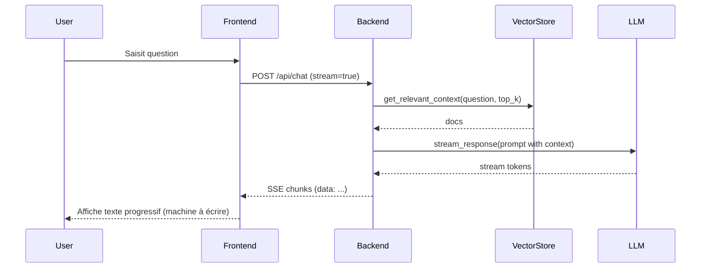
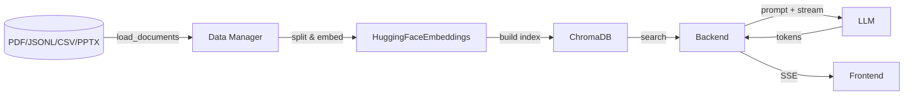
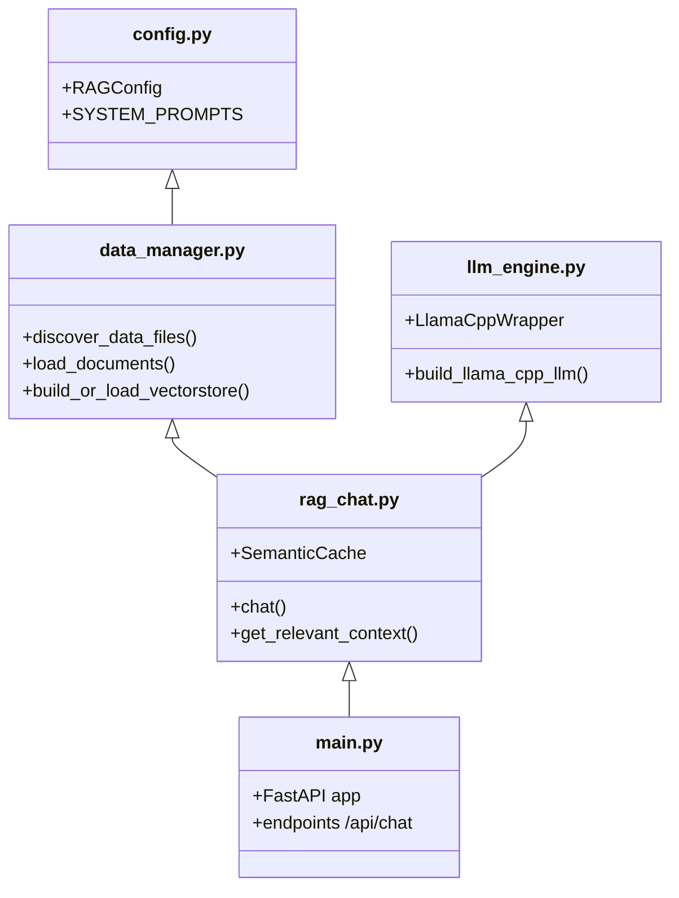

# 🚀 PROJET LUMINA : Assistant IA RAG Expert (Erasmus+)

## 🌟 1. Vision et Objectif du Projet
**Lumina** est un chatbot d'Intelligence Artificielle de pointe, conçu pour répondre instantanément et avec une précision millimétrique aux questions des utilisateurs (Étudiants, Établissements, Associations) concernant le programme Erasmus+.
Contrairement à un ChatGPT classique qui peut halluciner ou inventer des réponses, Lumina utilise une architecture **RAG (Retrieval-Augmented Generation)** couplée à un **LLM local**, garantissant ainsi que 100% des réponses proviennent strictement de la documentation officielle fournie.

---

## 🏗️ 2. Architecture Globale (De A à Z)

Le projet a été développé selon les standards modernes de l'industrie (Séparation Claire des Préoccupations - *Separation of Concerns*) :

### A. Le Frontend (Interface Utilisateur)
- **Technologies** : React, TypeScript, Vite, Tailwind CSS, composants Shadcn/UI.
- **Rôle** : Offrir une interface utilisateur moderne, réactive et fluide.
- **Fonctionnalité clé** : Intègre le *Server-Sent Events (SSE)* pour un affichage de la réponse en **streaming** (effet machine à écrire), procurant une expérience utilisateur naturelle et instantanée, sans attendre que l'IA ait fini de générer toute sa phrase.

### B. Le Backend (Le Cerveau de l'IA)
- **Technologies** : Python, FastAPI, Uvicorn.
- **Rôle** : Servir d'API (Pont) entre l'interface visuelle et le modèle d'IA. Il reçoit la question, effectue la recherche et "stream" la réponse vers l'avant.
- **Architecture Modulaire** :
  - `config.py` : Les réglages (tailles, chemins, prompts).
  - `data_manager.py` : Chargement des fichiers et Base Vectorielle.
  - `llm_engine.py` : Chargement du modèle de langage local via `llama-cpp`.
  - `rag_chat.py` : La logique du chat, le multi-profils et le Cache.
  - `main.py` : Le serveur FastAPI.

### C. La Base Vectorielle (La Mémoire à Long Terme)
- **Technologies** : ChromaDB, Sentence-Transformers (modèle multilingue).
- **Rôle** : Convertir tous les documents (PDF, JSON, Powerpoint) en vecteurs mathématiques. 

### D. Le Modèle d'IA (Le Raisonnement)
- **Technologie** : Modèle GGUF (`Phi-3-mini` optimisé).
- **Avantage** : Tourne 100% en local. **Aucune donnée n'est envoyée à OpenAI ou sur le cloud.** Confidentialité et souveraineté totale sur les données utilisateurs.

---

## ⚡ 3. Fonctionnalités Avancées (Points forts pour la présentation)

1. **Filtrage par Profils :** L'algorithme détecte automatiquement si l'utilisateur est un "étudiant" ou une "association", limitant la recherche ChromaDB uniquement aux documents qui le concernent pour éviter la confusion.
2. **Le Cache Sémantique Persistant :** Si deux utilisateurs posent la même question tournée différemment (ex: *"Bourse pour le master"* vs *"Existe-t-il des aides financières ?"*), Lumina contourne la génération IA coûteuse et sert directement la réponse depuis un cache mathématique, divisant le temps de réponse par 10.
3. **Mécanismes Anti-Hallucination :** Des prompts stricts, un nettoyage en post-génération, et un formatage forcé obligent l'IA à répondre *"Information introuvable"* s'il manque des données, plutôt que d'inventer de fausses procédures Erasmus.
4. **Dockérisation Complète :** Le projet est conteneurisé. (Voir section 4).

---

## 🐳 4. Déploiement et Conteneurisation (Docker)

Le projet possède un niveau professionnel de livraison grâce à **Docker**. Tous les environnements de développement (Python, dépendances complexes, compilateur C++, Node.js) ont été scellés dans des "images", garantissant l'adage : *"Construis-le une fois, exécute-le partout"*.

- **`backend/Dockerfile`** : Basé sur `python:3.10-slim`. Il s'occupe de compiler `llama-cpp` et d'initialiser FastAPI.
- **`Chat Bot/Dockerfile`** : Construction multi-étapes (Multi-stage build). Compile le React léger avec Vite, puis le sert via un serveur web de production ultra-rapide (Nginx).
- **`docker-compose.yml`** : Le chef d'orchestre. Il lance les deux sous-systèmes, lie leurs réseaux, et **monte les dossiers volumineux en volume local** (`/data`, `/models`, `/db_rag`) ce qui maintient les conteneurs très légers sans dupliquer des gigaoctets de données.

---

## 💻 5. Guide d'Utilisation

### A. Lancer pour le Développement (Méthode Manuelle)
Utile pour faire des modifications de code et les voir en temps réel.
1. **Frontend** : Ouvrir un terminal dans `Chat Bot/` > `npm run dev`.
2. **Backend** : Activer l'environnement Python (`conda activate chatbot_langchain`) > `python -m backend.main`.

### B. Lancer pour la Production / Présentation (Méthode Docker)
Idéal pour prouver la portabilité et déployer la solution finale.
1. Depuis la racine du projet, lancer la construction :
   ```bash
   docker-compose up --build
   ```
2. Accéder à l'application web via l'adresse locale standard : `http://localhost`.

---

## 🚀 6. Conclusion (Argumentaire pour le Jury)
Lumina n'est pas qu'un simple concept (PoC, comme l'était le Notebook initial). 
C'est désormais un produit **Full-Stack, micro-servicé, conteneurisé, privé et sécurisé**, apte à être hébergé sur des serveurs universitaires ou gouvernementaux, abaissant drastiquement les coûts de licence (pas d'API cloud payantes) tout en respectant le RGPD.

---

## 📊 7. Diagrammes et Cas d'utilisation
Ci-dessous se trouvent plusieurs diagrammes Mermaid pour illustrer l'architecture, les séquences, le déploiement, les cas d'utilisation et les flux de données — utiles pour votre présentation technique.

**Architecture Système (Composants)**
```mermaid
graph LR
  A[Frontend (React / Vite)] -->|POST /api/chat (SSE)| B[Backend (FastAPI / Uvicorn)]
  B --> C[Data Manager]
  C --> D[ChromaDB (Vector Store)]
  B --> E[LLM local (llama-cpp, GGUF)]
  B --> F[Semantic Cache]
  D -->|documents embeddings| F
  style A fill:#f9f,stroke:#333,stroke-width:1px
  style B fill:#bbf,stroke:#333,stroke-width:1px
  style D fill:#bfb,stroke:#333,stroke-width:1px
  style E fill:#ffd,stroke:#333,stroke-width:1px
```

**Séquence (exécution d'une requête - streaming)**


**Déploiement (docker-compose)**
```mermaid
graph TD
  subgraph Host
    direction TB
    A[./models]---C[volume]
    B[./db_rag]---C
    D[./data]---C
  end

  subgraph DockerNetwork
    backend[lumina-backend:3000]
    frontend[lumina-frontend:80]
  end

  C --> backend
  backend --> frontend
  note right of backend: expose 3000
  note right of frontend: expose 80
```

**Cas d'utilisation (Use Cases)**
```mermaid
%%{init: {'theme':'default'}}%%
usecaseDiagram
  actor Student as S
  actor Admin as A
  actor System as Sys

  S --> (Ask question)
  S --> (View sources/links)
  S --> (Clear session history)

  A --> (Reindex data)
  A --> (Manage models)
  A --> (Monitor logs / usage)

  Sys --> (Serve SSE stream)
  Sys --> (Persist semantic cache)
```

**Flux de données (Data Flow)**


**Composants Internes (Vue développeur rapide)**


---


